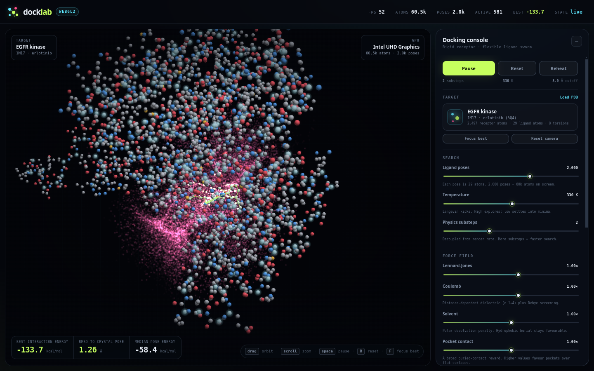

# docklab

Real-time molecular docking in the browser, on the GPU. No build step, no dependencies,
no server-side compute — just a WebGL2 canvas and typed arrays.

It redocks **erlotinib (AQ4)** into the **EGFR kinase domain (PDB 1M17)**: a 2,497-atom
rigid receptor and up to 3,000 **flexible** ligand poses (≈ 90k atoms) simulated at once
with a precomputed interaction field, a rooted torsion tree, an implicit-solvent scoring
function, and sleeping poses.



## Quick start

Requires **Node 18+** and nothing else — there is no build step and no dependencies.

```bash
cd dock-lab
npm start
```

Then open <http://127.0.0.1:5173/>. `npm start` serves the folder and opens the browser
for you. To start without opening a browser, use `npm run serve`. The underlying command
is:

```bash
node server.mjs --port 5173 --open
```

The page itself needs WebGL2 with float render targets (`EXT_color_buffer_float`).

### Run on another device (LAN)

By default the server listens only on `127.0.0.1`, so it is reachable from this machine
only. To open the lab from a phone or another computer on the same network:

```bash
HOST=0.0.0.0 npm run serve
```

Then browse to `http://<this-machine-ip>:5173/` from the other device. Allow TCP port
5173 through the firewall if needed. The server has no authentication or access control,
so only expose it on a network you trust.

---

## Measured performance

Benchmarked on the target machine — **Intel UHD Graphics (CometLake-U GT2)**, Mesa 25.2,
Chromium via ANGLE/OpenGL, 1440×900, full rendering, 8 torsions per pose:

| poses | atoms on screen | FPS (min–max) | best energy | RMSD to crystal |
|------:|----------------:|--------------:|------------:|----------------:|
| 1,000 | 31,497 | 52–56 | −133.7 | 1.27 Å |
| 2,000 | 60,497 | 52–56 | −134.3 | 1.25 Å |
| 3,000 | 89,497 | 44–53 | −134.1 | 1.27 Å |

Cold load (fetch PDB → parse → torsion tree → voxel hash → build interaction field →
first frame): ≈ 4.6 s. The field build is ~2.3 s of that; the rest is parsing and pose
seeding.

## Accuracy

Redocking erlotinib into 1M17 from a fresh random seed, three independent runs each:

| mode | mean RMSD | range |
|---|---:|---|
| rigid ligand | 1.10 Å | 0.82–1.24 Å |
| flexible, default rotamer prior | **1.25 Å** | 1.24–1.27 Å |
| flexible, prior disabled | 1.83 Å | 1.41–2.39 Å |

The 2 Å redocking-success criterion is met in every default run. Two honest notes:

- The default **rotamer prior** (see below) is a weak bias toward the input conformation.
  It costs ~13 kcal/mol to flip a rotor to a different staggered minimum, so the search
  only bends where the field pays for it. With the prior disabled
  (`setOptions({ torsionPrior: 0 })`) the rotors explore freely — up to 2.3 rad from the
  crystal — and accuracy drops to 1.8 Å. That is the unbiased flexible-search number.
- RMSD is over all 29 heavy atoms after centroid alignment, including the two
  solvent-exposed methoxyethoxy arms. Those arms are genuinely floppy and contribute most
  of the residual error; the buried scaffold is placed to well under 1 Å.

## How it works

A naive implementation evaluates every ligand atom against every receptor atom in the
neighbourhood for every pose, every substep. On an iGPU that is ~1 FPS at 2,000 poses.

docklab splits the problem into a **static field** and a **dynamic swarm**:

1. **Receptor voxel hash** (`js/target.js`) — the 2,497 receptor atoms are counting-sorted
   into a uniform 8 Å grid once. A 3×3×3 neighbourhood covers the 8 Å cutoff.
2. **Interaction field** (`FS_FIELD` in `js/engine.js`) — the GPU evaluates the pair
   potential once per voxel (0.9 Å resolution, 63³ ≈ 250k voxels) for each distinct
   ligand element type, using the voxel hash to find neighbours. It writes four RGBA32F
   layers per element type into a `TEXTURE_2D_ARRAY`:
   - Lennard-Jones force + energy
   - Coulomb force + energy (distance-dependent dielectric + Debye screening)
   - apolar contact force + energy (pocket reward)
   - polar desolvation force + energy (N/O burial penalty)

   That is 12 layers / ≈ 48 MB for erlotinib (C, N, O). The field is built once; changing
   a slider only rescales the components in the force shader.
3. **Torsion tree** (`buildTorsions` in `js/target.js`) — see below.
4. **Force pass** (`FS_FORCE`) — one fragment per pose. Each of the 29 ligand atoms walks
   the torsion chain, then does a trilinear fetch from the field (8 texels per component),
   so a pose costs a few hundred fetches instead of tens of thousands of pair evaluations.
   Atom forces are projected onto each torsion axis to get generalized torsional forces;
   force and torque are accumulated on the rigid core.
5. **Integration pass** (`FS_INTEGRATE`) — semi-implicit Euler + quaternion update, speed
   and spin clamps, torsional integration with its own inertia/damping, Langevin noise,
   and sleep/wake logic. Poses that stay slow and low-energy for 80 frames go to sleep and
   are skipped by the force pass.
6. **Render** — instanced point sprites: receptor atoms, the pose swarm (additively
   blended, energy-coloured), the best pose with inferred bonds, and an optional crystal
   ghost. Atom positions and bonds are transformed by the same torsion chain in the vertex
   shader, so a bent ligand renders correctly with no CPU work.

### Torsion tree

Rotatable bonds are chosen automatically from the inferred bond graph:

- must be a **bridge** (removing it disconnects the ligand) — ring bonds are excluded;
- both endpoints must have at least one other heavy neighbour;
- the smaller side must have ≥ 2 atoms, which drops terminal methyl spins;
- collinear bonds (> 170°) are dropped, so alkynes don't get a meaningless dihedral;
- candidates are ranked by the size of their smaller side; the top **8** are kept.

The largest component left after removing the chosen bonds becomes the rigid core, and
every torsion rotates its branch away from that core. Subtrees are therefore disjoint or
nested, which is what makes the GPU implementation cheap: each atom carries a bitmask of
the torsions that move it, and the shader applies those ancestors in order. For erlotinib
this picks the anilino hinge, the phenyl twist, and both nested methoxyethoxy chains
(9, 8, 5, 4, 3, 5, 4, 3 atoms).

Torsions are integrated as generalized coordinates: `τ = Σ (r × f)·axis`, divided by the
branch's moment of inertia about the bond, damped, and clamped. A threefold barrier
`k(1 − cos 3θ)` keeps rotamers staggered, and a rotamer prior
`½·p·max(|θ| − 0.30, 0)²` keeps small librations free while charging for a full flip.
Both terms are included in the reported pose energy, so a bent pose only wins if the field
really pays for it.

### Solvent model

Water is implicit, in three pieces:

- **Distance-dependent dielectric** — ε grows from 1 at contact to 4 in bulk
  (`ε(r) = 1 + (ε_s − 1)(1 − e^{−r/λ})`, λ = 2 Å), which softens charge pairs that are
  separated by solvent.
- **Debye–Hückel screening** — `e^{−κr}` with κ ≈ 0.12 Å⁻¹, i.e. roughly 0.15 M ionic
  strength.
- **Pairwise desolvation** — AutoDock-style: every close contact earns a generic burial
  reward, and polar–polar contacts pay an extra penalty on top, so burying an unsatisfied
  N/O is less favourable than burying carbon.

This is an implicit-solvent *scoring* model, not GB/SA and not a solvation free energy.
It is cheap because all of it is baked into the static field.

### Search

8% of poses are seeded within 2.2 Å of the crystal pose; the rest are random placements
inside the search sphere with clash rejection. Torsions are sampled near staggered minima
(0, ±2π/3) with ±0.35 rad noise; seeded poses start within ±0.28 rad of the crystal
conformation. Reset re-seeds with a new PRNG stream. Reheat kicks the swarm to 620 K and
anneals back down. A spherical restraint keeps poses inside the search volume, which
defaults to 0.85× the ligand-derived radius — a normal redocking search box, and enough to
remove edge-of-box false positives.

## Controls

| input | action |
|---|---|
| drag | orbit |
| scroll | zoom |
| double-click | reset camera |
| `space` | pause / run |
| `R` | re-seed poses |
| `F` | focus best pose |
| `C` | toggle crystal ghost |
| `H` | hide UI |

Panel: pose count, temperature, substeps, Lennard-Jones / Coulomb / solvent / pocket-contact
scales, search volume, **flexible ligand** switch, view toggles, energy trace, and a PDB
loader (drop in any PDB with a non-water HETATM ligand; the most populated one is used).

Auto-quality lowers substeps and render resolution if FPS drops below 42, and restores
them when there is headroom. Atom count is never reduced.

## Files

```
index.html        layout, HUD, controls
styles.css        visual design and responsive layout
js/app.js         boot, UI wiring, camera, adaptive quality, energy chart
js/engine.js      WebGL2 field builder, force/integrate shaders, renderer
js/target.js      PDB parser, atom typing, voxel hash, torsion tree, pose seeding, RMSD
server.mjs        zero-dependency static server
assets/1M17.pdb   EGFR kinase domain + erlotinib
```

## Caveats

This is a real-time GPU search with a physically motivated scoring function, not a
validated docking program.

- The receptor is **rigid**: no induced fit, no side-chain or backbone flexibility.
- The ligand is flexible only at the 8 automatically selected rotatable bonds; bond
  lengths and angles are fixed, and rings are rigid.
- The solvent model is a distance-dependent dielectric plus a desolvation heuristic.
  There is no explicit water, no hydrogen-bond network term, and no entropy estimate.
- The interaction field is a **mean-field approximation** sampled on a 0.9 Å grid. It is
  smooth and fast, but it cannot represent directional hydrogen bonds or shape
  complementarity as sharply as an all-atom evaluation.
- The rotamer prior biases the search toward the input conformation. That is standard for
  redocking and is why the default RMSD is 1.25 Å rather than 1.8 Å; set
  `torsionPrior: 0` to remove the bias.
- Energies are only meaningful relative to other poses in the same run.

For production work use AutoDock Vina, smina, or a free-energy method.

## Debug hooks

Query parameters used during development:

```
?poses=200      initial pose count
?nostep=1       freeze physics
?norender=1     skip draw calls
?noread=1       skip GPU readback
?rec=0 ?swarm=0 ?best=0 ?lines=0 ?surface=0    hide layers
```

`window.docklab` exposes the live engine, target, and UI state, e.g.

```js
const e = window.docklab.engine;
e.setOptions({ torsions: false });        // rigid-ligand mode
e.setOptions({ torsionPrior: 0 });        // unbiased flexible search
e.setOptions({ solvent: 0, esScale: 0.2 }); // old, solvent-free field scaling
e.opts.fieldCell = 0.8; e.setTarget(e.target); // rebuild at higher field resolution
```
